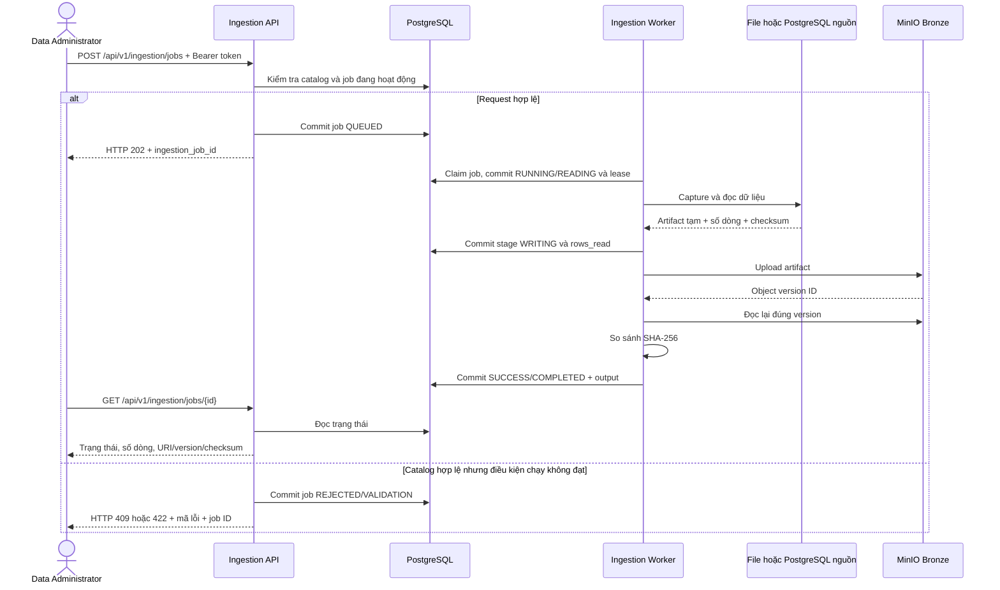

# UDL-12: Flow hoạt động và báo cáo bàn giao Data Ingestion

Ngày cập nhật: 17/10/2026. Ngôn ngữ lệnh: Bash/Zsh, chạy từ thư mục gốc repo.

Task: [UDL-12 - Nạp dữ liệu đa nguồn](https://photopose.atlassian.net/browse/UDL-12).

## 1. Mục tiêu và kết luận

Hệ thống tiếp nhận dữ liệu từ Admissions, Academic/Training và Human Resources,
sử dụng cấu hình nguồn trong catalog, thực thi batch ingestion, lưu dữ liệu thô
vào Bronze và ghi nhận trạng thái/lỗi của từng lần chạy.

Trong đợt kiểm chứng này, cả ba domain đã chạy thành công qua API, PostgreSQL
queue, worker và MinIO Bronze. Ca nguồn/dataset không khớp bị từ chối; ca file
không tồn tại được ghi nhận FAILED. Test giả lập writer lỗi đã PASS.

Đủ bằng chứng cho bộ kiểm thử bàn giao đã thống nhất trong đợt này. Lỗi ghi
storage được kiểm thử bằng mock, không phải sự cố MinIO end-to-end. Không suy
kết quả này thành toàn bộ test suite xanh hoặc chứng nhận sẵn sàng production.
Quyết định nghiệm thu chính thức thuộc người phụ trách task.

Phạm vi UDL-12 dừng ở **Source -> Bronze**. Chưa tự chạy chuẩn hóa S2/S3/S4,
Silver, Gold, Dashboard hoặc NLQ khi job ingestion thành công.

## 2. Các thành phần và nơi lưu dữ liệu

| Thành phần | Vai trò |
|---|---|
| `app.source_system` | Hệ thống sở hữu nguồn: ADM_SYS, ACA_SYS, HR_SYS |
| `app.data_source` | Loại nguồn, location, configuration và thống kê ingestion |
| `app.data_layer` | Khai báo tầng dữ liệu; job này yêu cầu BRONZE |
| `app.dataset` | Bộ dữ liệu đích, domain và liên kết với source system/layer |
| `app.ingestion_job` | Queue bền vững, lịch sử thực thi, số dòng và output |
| FastAPI | Xác thực, nhận yêu cầu tạo job, cung cấp API theo dõi |
| Ingestion worker | Nhận job từ PostgreSQL, đọc nguồn và ghi Bronze |
| MinIO nguồn | Chứa file đầu vào trong đợt demo, bucket `unilake-raw` |
| MinIO Bronze | Chứa file đã ingest, bucket cấu hình qua MINIO_BUCKET_BRONZE |

`data_source_id` và `dataset_id` là hai ID độc lập. Chúng không bắt buộc bằng
nhau, nhưng hai bản ghi phải có cùng `source_system_id`.

Ví dụ: nguồn Academic CSV có ID 4 sử dụng dataset Academic ID 2. Đổi tên file
trong request không biến nguồn Admissions thành nguồn Academic.

MinIO lưu object; PostgreSQL lưu catalog và metadata job. Khi chạy MinIO bằng
Compose ở local, bytes của object nằm trong Docker volume `minio_data`.

## 3. Flow tổng thể



Không có worker thì job vẫn QUEUED. API trả 202 chỉ xác nhận đã lưu yêu cầu;
phải đợi SUCCESS mới xác nhận ingestion hoàn tất.

### 3.1. Kiểm tra trước khi enqueue

1. Token phải có role ADMIN hoặc DATA_ADMIN để tạo job.
2. Source và dataset phải tồn tại. Thiếu một trong hai trả INGESTION_NOT_FOUND.
3. Source và SourceSystem phải active.
4. Dataset phải ACTIVE, thuộc BRONZE, cùng source system với nguồn.
5. Domain phải là slug hợp lệ để tạo partition.
6. Reader, cấu hình và tên file/bảng phải hợp lệ.
7. Nguồn chưa có job EXECUTION_V1 ở trạng thái QUEUED hoặc RUNNING.

Worker kiểm tra lại catalog khi bắt đầu xử lý, vì cấu hình có thể thay đổi sau
khi enqueue. Location và credentials được lấy từ catalog/settings, không nhận
tùy ý trong payload tạo job.

### 3.2. Worker và queue

- Worker claim bằng `SELECT ... FOR UPDATE SKIP LOCKED`.
- Unique partial index ngăn một nguồn có nhiều job đang hoạt động.
- Mỗi worker xử lý một job tại một thời điểm; nhiều worker có thể xử lý các nguồn khác nhau.
- Heartbeat mỗi 15 giây, lease dài 120 giây.
- Worker quét job RUNNING hết lease và đánh dấu FAILED/WORKER_LEASE_EXPIRED.
- Không tự retry job hết lease; caller tạo request mới nếu muốn chạy lại.
- Khi không có job, worker nghỉ khoảng 2 giây trước chu kỳ tiếp theo.

### 3.3. Capture, reader và Bronze writer

CSV/Excel: resolve S3 nếu cần, copy sang file tạm riêng rồi parse chính bản sao
đó. Bronze lưu nguyên bytes của bản sao, không dựng lại CSV/Excel từ rows đã parse.
CSVReader sử dụng DuckDB; ExcelReader sử dụng openpyxl.

PostgreSQL: reader sử dụng DuckDB postgres extension, đọc bảng vào bộ nhớ và
capture thành `snapshot.parquet` bằng PyArrow để giữ kiểu dữ liệu. Đây là full
snapshot, chưa phải CDC hoặc incremental ingestion.

Writer yêu cầu bucket Bronze bật versioning, upload rồi đọc lại **đúng version**
để đối chiếu SHA-256 trước khi công bố thành công. File tạm được dọn sau xử lý.

Key đích:

```text
s3://<bronze-bucket>/<domain>/YYYY/MM/DD/job-<ingestion_job_id>/<filename>
```

Partition lấy ngày tạo job theo Asia/Ho_Chi_Minh. Timestamp trong metadata hiện
lưu UTC dạng không kèm timezone; khi hiển thị phải diễn giải là UTC.

`output` gồm `uri`, `version_id`, `sha256`, `size_bytes`, `source_version_id`.
`source_version_id` có thể null nếu nguồn không cung cấp version; không đồng
nghĩa thiếu version của object đích Bronze.

## 4. Trạng thái và lỗi

| Trường hợp | HTTP / trạng thái job | Mã lỗi hoặc stage |
|---|---|---|
| Tạo job hợp lệ | 202 / QUEUED | QUEUED |
| Worker nhận job | RUNNING | READING, sau đó WRITING |
| Hoàn tất | SUCCESS | COMPLETED |
| JSON hoặc payload sai | 422, không tạo job | Lỗi validation của FastAPI/Pydantic |
| Source hoặc dataset không tồn tại | 404, không tạo job | INGESTION_NOT_FOUND |
| Dataset sai nguồn hoặc không ACTIVE | 422 / REJECTED | DATASET_SOURCE_MISMATCH_OR_INACTIVE |
| Dataset không thuộc Bronze | 422 / REJECTED | BRONZE_DATASET_REQUIRED |
| Nguồn đang có job hoạt động | 409 / REJECTED | SOURCE_ALREADY_RUNNING |
| Không đọc/capture được nguồn | FAILED | INGESTION_READING_FAILED |
| Ghi Bronze, versioning hoặc checksum lỗi | FAILED | INGESTION_WRITING_FAILED |
| Hoàn tất metadata lỗi | FAILED nếu DB còn truy cập được | INGESTION_COMMITTING_FAILED |
| Lease hết hạn | FAILED | WORKER_LEASE_EXPIRED |

Trong code, COMMITTING là biến bước thực thi để phân loại lỗi; không có lần cập
nhật stage COMMITTING riêng xuống database trước `finish()`.

Job thành công có `rows_written = rows_read`, `rows_rejected = 0`. Các số này
phản ánh số record parser đọc được; không phải bước loại dữ liệu nghiệp vụ.
`ingestion_count` chỉ tăng khi thành công; `last_ingested_at` cũng chỉ đổi khi
thành công. Lỗi public chỉ chứa mã kiểm soát, tránh lộ credentials/raw values.

## 5. Bằng chứng kiểm thử ngày 17/10/2026

Các response và ảnh SQL do người thực hiện cung cấp trong buổi kiểm thử được
đối chiếu với file giả lập đã seed. Bảng dưới ghi nhận kết quả của môi trường
dev đó, không phải ID cố định để hard-code trên môi trường khác.

| Ca | Job | Nguồn / dataset | Kết quả | Mức kiểm chứng |
|---|---:|---|---|---|
| Admissions CSV | 1 | 1 / 1 | SUCCESS, đọc 3, ghi 3 | API, worker, PostgreSQL, MinIO thật |
| Nguồn/dataset không khớp | 2 | Request Admissions -> Academic | Bị từ chối, DATASET_SOURCE_MISMATCH_OR_INACTIVE | Response API thật |
| Academic CSV | 3 | 4 / 2 | SUCCESS, đọc 3, ghi 3, rejected 0 | API, worker, PostgreSQL, MinIO thật |
| HR CSV | 4 | 5 / 3 | SUCCESS, đọc 3, ghi 3, rejected 0 | API, worker, PostgreSQL, MinIO thật |
| File không tồn tại | 6 | 7 / 3 | FAILED, rows_written 0, output null | API, worker, PostgreSQL, MinIO thật |
| Writer phát sinh exception | Không tạo job thật | Test parameter `[write]` | PASSED, gọi finish với INGESTION_WRITING_FAILED | Unit test với repository/writer mock |

Job 5 là lần dùng nguồn HR hợp lệ nhưng truyền `missing.csv` thay vì tên file
được cấu hình. Không dùng job này làm bằng chứng file nguồn không tồn tại.

### 5.1. Các object Bronze thành công

| Domain | URI |
|---|---|
| Admissions | `s3://bronze/admissions/2026/10/17/job-1/applicants.csv` |
| Academic | `s3://bronze/academic/2026/10/17/job-3/02-academic.csv` |
| HR | `s3://bronze/hr/2026/10/17/job-4/03-hr.csv` |

Academic: 180 bytes, version `f45fccde-9a95-418d-a022-7d8d70980ec2`, SHA-256:

```text
86839b09a84c08f47c6c2150b5defb2bcacbab8ccce3d6276e13a499aed814fb
```

HR: 106 bytes, version `e3ffdfa8-7e86-4c84-b67a-8dfa9cafa262`, SHA-256:

```text
68adf995ebe27e56ee9a874b12ecb53764c7d12db32d376a6a6f5caba01b2865
```

Hai checksum trên khớp file demo đã upload. Admissions có version và checksum
trong ảnh SQL; checksum bị cắt trong ảnh nên không chép thành chuỗi đầy đủ ở đây.

Job 6: error `INGESTION_READING_FAILED`, bắt đầu 08:10:08.634850 UTC và kết thúc
08:10:08.693005 UTC ngày 17/10/2026, không tạo output Bronze.

### 5.2. Test lỗi đọc/ghi và nhánh thành công

Người thực hiện đã chạy và cung cấp output cả ba parameter PASSED:

```bash
PYTHONPATH=backend .venv/bin/python -m pytest \
  backend/tests/test_ingestion_execution.py \
  -k execution_stages_and_sanitized_failures \
  -o addopts='' -v
```

Các parameter: `[read]`, `[write]`, `[None]`. Đây là test service với mock;
không tạo job hoặc làm hỏng MinIO thật. Chưa có bằng chứng mới trong đợt này
về mất kết nối MinIO end-to-end, race nhiều worker hoặc lease recovery thực tế.

## 6. Đối chiếu các subtask

| Subtask | Phần đã có | Bằng chứng bàn giao |
|---|---|---|
| UDL-121: Thiết kế quy trình | Flow batch, contract, metadata và các nhánh lỗi | Tài liệu này và ingestion-execution.md |
| UDL-122: Tiếp nhận ba domain | Reader dùng catalog, nguồn CSV cho ba domain | Job 1, 3, 4 |
| UDL-123: Thực thi/điều phối | API, durable queue, worker, validation và lease | Job thực tế từ QUEUED đến trạng thái cuối |
| UDL-124: Lưu Bronze | Giữ raw file, partition, version/checksum, metadata | Ba URI Bronze và output của job |
| UDL-125: Trạng thái/lỗi | Lịch sử job, timestamp, số dòng, mã lỗi kiểm soát | Job thành công, lỗi mismatch, job 6 FAILED |
| UDL-126: Tích hợp/kiểm thử | Ba domain chạy thật, lỗi đọc thật, lỗi ghi mock | Bảng kiểm thử ở mục 5; ghi rõ giới hạn mock |

## 7. Cách chạy lại cho thành viên tiếp theo

### 7.1. Migration và dependencies

Với database đã có volume, chạy migration bổ sung, không xóa volume:

```bash
docker compose exec -T postgres sh -c \
  'psql -v ON_ERROR_STOP=1 -U "$POSTGRES_USER" -d "$POSTGRES_DB"' \
  < infra/postgres/migrations/20261015_ingestion_execution.sql
```

Migration thêm `source_table`, `created_at`, `requested_by`, `stage`,
`lease_expires_at`, `output` và hai index:
`uq_ingestion_execution_active_source`, `ix_ingestion_execution_queue`.
Đợt dev này đã xác nhận đủ sáu cột và hai index.

Worker Docker dùng `backend/requirements-worker.txt`, tránh cài LangChain,
Great Expectations và OR-Tools. Backend vẫn dùng requirements.txt. Dockerfile
có BuildKit cache pip và tách lớp dependencies khỏi pyproject metadata.

```bash
docker compose build ingestion-worker
docker compose up -d ingestion-worker
docker compose ps -a ingestion-worker
docker compose logs --tail=80 ingestion-worker
```

Image worker gọn đã build thành công; chạy container kiểm tra import, extension
PostgreSQL, chu kỳ queue và bucket Bronze thành công trong đợt này.

Hoặc chạy local, sau khi cài dependencies worker vào virtualenv:

```bash
.venv/bin/python -m pip install -r backend/requirements-worker.txt
PYTHONPATH=backend .venv/bin/python -m app.ingestion_worker
```

Chọn một cách chạy khi demo để dễ theo dõi. Worker local từng được dùng trong
buổi này; PID không phải thông tin cố định cho lần chạy sau.

Endpoint host thường là PostgreSQL localhost:5434 và MinIO localhost:9000;
trong Compose là postgres:5432 và minio:9000. Cấu hình thực tế lấy từ `.env`.
Không chép password/token vào tài liệu hoặc log. Local và Docker có môi trường
Python riêng; cài pyarrow vào `.venv` không tự cài vào image.

### 7.2. Dữ liệu và seed demo

| File local | Location nguồn trên MinIO | Seed SQL |
|---|---|---|
| `data/ingestion-demo/academic/02-academic.csv` | `s3://unilake-raw/demo/academic/02-academic.csv` | `scripts/standardization/seed_academic_ingestion.sql` |
| `data/ingestion-demo/hr/03-hr.csv` | `s3://unilake-raw/demo/hr/03-hr.csv` | `scripts/standardization/seed_hr_ingestion.sql` |
| Không tạo missing.csv | `s3://unilake-raw/demo/hr/missing.csv` | `scripts/standardization/seed_missing_csv_test.sql` |

Các file Academic/HR là dữ liệu giả lập, mỗi file ba record. SQL chỉ đăng ký
catalog, **không upload file**. Hai object nguồn đã upload trên môi trường dev
này; ở môi trường mới phải upload vào đúng bucket/key trước khi chạy ingestion.
Nguồn `ACA_SYS`, `HR_SYS` phải tồn tại và active trước khi chạy seed.

```bash
docker compose exec -T postgres sh -c \
  'psql -v ON_ERROR_STOP=1 -U "$POSTGRES_USER" -d "$POSTGRES_DB"' \
  < scripts/standardization/seed_academic_ingestion.sql

docker compose exec -T postgres sh -c \
  'psql -v ON_ERROR_STOP=1 -U "$POSTGRES_USER" -d "$POSTGRES_DB"' \
  < scripts/standardization/seed_hr_ingestion.sql

docker compose exec -T postgres sh -c \
  'psql -v ON_ERROR_STOP=1 -U "$POSTGRES_USER" -d "$POSTGRES_DB"' \
  < scripts/standardization/seed_missing_csv_test.sql
```

Seed không cập nhật đè cấu hình nguồn đã có. Đọc ID từ kết quả SELECT cuối file,
không giả định ID trên máy khác giống bảng dưới.

| Nguồn trên môi trường kiểm thử | data_source_id | dataset_id | source_table |
|---|---:|---:|---|
| Admissions CSV | 1 | 1 | applicants.csv |
| Academic CSV demo | 4 | 2 | 02-academic.csv |
| HR CSV demo | 5 | 3 | 03-hr.csv |
| HR Missing CSV Test | 7 | 3 | missing.csv |

Nguồn Academic ID 3 vẫn là REST_API, chưa được reader hiện tại hỗ trợ; không
dùng nguồn đó với file CSV. Mã nguồn demo không thay thế việc triển khai API
reader nếu loại nguồn đó trở thành yêu cầu bắt buộc.

### 7.3. Gọi API

Đăng nhập lấy token thật có ADMIN/DATA_ADMIN. Trên Swagger hoặc HTTP client,
gửi `POST /api/v1/ingestion/jobs` với Bearer token và JSON, ví dụ HR trên môi
trường đã seed trong buổi này:

```json
{
  "data_source_id": 5,
  "dataset_id": 3,
  "source_table": "03-hr.csv"
}
```

Theo dõi `GET /api/v1/ingestion/jobs/{id}` bằng ID vừa trả về. Có thể liệt kê
bằng `GET /api/v1/ingestion/jobs?data_source_id=5&limit=20&offset=0`.
Role đọc được hỗ trợ: ADMIN, DATA_ADMIN, ANALYST, VIEWER.

Để chạy ca file thiếu, dùng ID nguồn thử từ seed, dataset HR và `missing.csv`.
Không đổi location của nguồn HR hợp lệ để tạo lỗi.

### 7.4. SQL kiểm tra kết quả

Chạy trong SQL Editor hoặc psql:

```sql
SELECT j.ingestion_job_id, d.domain, j.data_source_id, j.dataset_id,
       j.status, j.stage, j.started_at, j.finished_at,
       j.rows_read, j.rows_written, j.error_message,
       j.output->>'uri' AS uri,
       j.output->>'version_id' AS version_id,
       j.output->>'sha256' AS sha256
FROM app.ingestion_job j
JOIN app.dataset d ON d.dataset_id = j.dataset_id
WHERE j.job_type = 'EXECUTION_V1'
ORDER BY j.ingestion_job_id DESC
LIMIT 20;
```

Không coi việc có bucket hoặc thấy file trong MinIO là đủ: phải đối chiếu job
SUCCESS và đúng object version trong output. PostgreSQL và MinIO không cùng
transaction; có thể còn object mồ côi nếu upload xong nhưng commit metadata lỗi.

## 8. Bản đồ mã nguồn

| File | Trách nhiệm |
|---|---|
| `backend/app/modules/ingestion/router.py` | API tạo, liệt kê và lấy job |
| `backend/app/modules/ingestion/schemas.py` | Payload và response |
| `backend/app/modules/ingestion/execution.py` | Validation, enqueue, điều phối đọc/ghi |
| `backend/app/repositories/ingestion_repo.py` | Persistence, claim, heartbeat, finish, recovery |
| `backend/app/ingestion_worker.py` | Vòng lặp worker và heartbeat task |
| `backend/app/bronze_capture.py` | Capture bytes, export DB, ghi và xác minh Bronze |
| `backend/app/modules/ingestion/readers/` | Contract, factory, request builder, CSV/Excel/PostgreSQL và S3 resolver |
| `backend/app/modules/ingestion/readers/source_loader.py` | API đọc nguồn; read_data_source không tạo job hoặc ghi Bronze |
| `backend/app/infra/minio/bronze.py` | Quy ước key, MinIO client và CLI upload |
| `backend/tests/test_ingestion_execution.py` | Unit test execution/capture và lỗi read/write |
| `backend/tests/test_ingestion_execution_live.py` | Suite opt-in với schema/bucket riêng; chưa chạy trong đợt bàn giao này |

Không nhầm `read_data_source()` với execution service: đọc thử thành công qua
loader chưa chứng minh dữ liệu đã được ghi vào Bronze.

## 9. Giới hạn và công việc tiếp theo

- Bằng chứng ba domain trong đợt này dùng CSV nhỏ, không phải benchmark dữ liệu lớn.
- Excel và PostgreSQL đã có reader, nhưng không phải bằng chứng live của ba job CSV này.
- REST API/JSON chưa có reader; chưa có scheduler tự thu thập định kỳ.
- Reader materialize kết quả trong memory; cần thiết kế giới hạn/streaming cho batch lớn.
- Lỗi ghi storage mới có bằng chứng mock, chưa gây lỗi MinIO thật ở môi trường cô lập.
- Chưa xác nhận toàn bộ repository suite, concurrency và recovery end-to-end trong lượt này.
- Chưa có distributed transaction PostgreSQL/MinIO hoặc quy trình dọn orphan tự động.
- Thông báo lỗi công khai được rút gọn; cần cơ chế chẩn đoán nội bộ nếu vận hành production.
- Chưa nối tự động job SUCCESS với pipeline Silver; thành viên làm bước sau cần đọc
  contract/provenance của pipeline thay vì chỉ scan bucket hoặc truyền rows thiếu metadata.
- Ghi nhận/duyệt bằng chứng nghiệm thu trên Jira theo quy trình của nhóm; tài liệu này
  không tự thay đổi trạng thái task hay phê duyệt nghiệp vụ.

## 10. Tài liệu liên quan

- [Chi tiết ingestion execution](ingestion-execution.md)
- [Bronze storage](bronze-storage.md)
- [Source readers](ingestion-source-readers.md)
- [Silver integration và giới hạn publication](standardization/silver-integration-p5.md)
- [Migration ingestion](../infra/postgres/migrations/20261015_ingestion_execution.sql)
